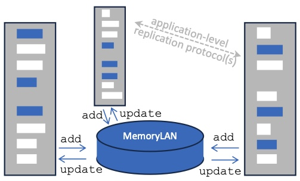

# MemoryLAN - A Local Area Content Replication Mesh

This repository contains working implementations of a "memory switch"
(in analogy to an "Ethernet switch") for forming a configuration-less
MemoryLAN that assists in replicating content within a confined
region.

A memory switch manages a cache of recently seen memory pages and
replicates its cache to the other switches while striving for
network-wide cache coherence.



The most prominent MemoryLAN use case is a wireless mesh network where
the in-network cache mitigates packet loss. LoRa and long range
Bluetooth Low Energy are two possible technologies on top of which the
MemoryLAN logic can easily operate.

See the [MemoryLAN whitepaper](docs/memoryLAN-whitepaper-20260723.pdf)
for an extended abstract.


## MemoryLAN API

The MemoryLAN software running on end nodes exposes a very simple
API. Implementations working directly at the OS level will roughly
follow this structure:

```
begin(medium_specific_parameters);
add(buffer, len);
get_update(buffer, &len);  // either polling or blocking
```

Alternatively, using a callback style:
```
void update_callback(buffer,len) {...}
begin(medium_specific_parameters, update_callback);
add(buffer,len);
```

Note that a MemoryLAN has no notion of addresses: Content injected via
the ```add()``` method will trigger an ```update()``` event on all
attached end nodes.

There is no guarantee of ordering nor duplicate supression and
reliability: Applications running on the end nodes have to filter and
potentially reorder incoming updates themselves, as well as to
implement some form of ARQ in order to catch the cases where added
content did not make it to all attached end nodes. The major service
provided by a MemoryLAN is the extension of raw broadcast to multi-hop
settings combined with best-effort cache coherence.

Historically, this project first aimed at supporting
[tinySSB](https://github.com/ssbc/tinySSB), hence has a MTU of 128
Bytes. Larger MTUs up to Ethernet's default size (1500 Bytes) are
possible but become cumbersome for low-end wireless technologies like
LoRa and, to some extend, also BLE.


## A Simple Mock Replicating Application ("Shared Shopping List")

In order to demonstrate the use of a MemoryLAN, we introduce a shared
whiteboard (think "shopping list") where each peer is allowed to
insert arbitrarily many new text lines and to tag any existing text
line for deletion.  The MemoryLAN is configured for only 4 cache
lines, wherefore the app instances periodically and randomly pick a
local text line and propagate it through the memory-constraint
MemoryLAN.  Nevertheless and eventually, all end nodes will share the
same list. In other words, the Shared Shopping List app uses a
randomized synchronization protocol.

Implementation detail: Text lines are solely identified by their
content and are sorted alphabetically for presentation purposes.  To
each line we attach an expiration date for implementing the delete
action. This assumes that the end devices have access to reasonably
synchronized absolute time. An end node that originates a delete
action may want to store the deleted item longer than the indicated
expiration time in order to handle network partitions. In our demo, we
have set this guard time to 5 minutes: Partitions that last for longer
than this time may lead to deleted items being seemingly resurrected
(while it was simply the case that the to-be-deleted information did
not make it to the other partition).

Note that except for the ESP32 case we have the end nodes running the
app as well as the memory switch logic in the same process. This
local memory switch module is analogous to the Network Interface Card
that Ethernet requires for attaching end nodes to the network.

## ESP32-based Implementation (BLE, LoRa)

The code in the ```esp``` directory implements the memory switch for
ESP32 CPUs that have BLE and LoRa transmission capabilities (only
using BLE is fine, too).

Note that the ESP32 implementation does not contain the Shared
Shopping List app due to lack if suitable input/output.

We use the [BleBC](https://github.com/tschudin/BleBC) library for
turning the BLE stack into a raw broadcast medium.


## Python Implementation (UDP multicast)

pending ...


## Kotlin Implementation (BLE, UDP multicast)

pending ...


## UNIX User Space Implementation (raw Ethernet/WiFi)

Most UNIX environments require special permission for promiscous LAN access.

pending ...

---