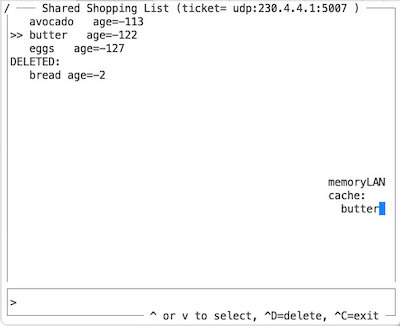

# Python Demo of a Shared Shopping List App runnning over MemoryLAN over UDP Multicast

This is a curses-based TUI application: Simpply start multiple
instances in different terminal windows on the same machine. In case
your LAN supports multicast, you can also run this code on other
machines in the LAN. All peers now share the same, fully replicated
shopping list.

## User-Level Experience

Peers can add new items to the list, delete existing ones, and re-add
items that were previously deleted. These changes will propagate to
all attached peers and eventually all peers will see the same
(alphabetically sorted) list.

Peers that join later will build the same list over time because each
peer informs the world about their entries by periodically and
randomly picking one and updating everybody about this pick. There are
more efficient synchronization protocols for sure, but for this demo
this is perfectly sufficient and simple.

## Behind the Fassade (1 of 3)

We use a last-writer-win (LWW) data structure where each item carries
a timestamp (absolute time). A positive value means this is an active
item, negative value means that it has been deleted.

An update will be merged into our local replica if it has a more
recent timestamp value. In this way, a more recent addition of
an already deleted item will prevail.

We applied a slight optimization of __not__ recording a "delete
update" in case we have never heard about that item. This relieves us
from storing "toombstone entries" for long forgotten items. The danger
of this optimization is that any outdated peer (not having seen the
latest delete update) can make us believe that an entry is active,
which we could have prevented only if we had stored all toombstones we
learned about.

## Behind the Fassade (2 of 3)

The shopping list updates have the "wire format"

```
  [ tag (20B) | timestamp (4B) | item text (variable length) ]
```

while for the MemoryLAN, this is just an opaque memory page to
be replicated to all attached peers.

The tag is a static random pattern identifying our SSL updates in
order to only act on meaningful updates (because the memoryLAN can
also be used by other applications in parallel).

```timestamp``` records the time when an update was created. It is
expressed as number of seconds since Jan 1, 1970 and can be either
positive, meaning that this is an update for an active item, or
negative for stating that this item was deleted at said time.

```text``` is a freeform string and identifies the item in the
shopping list. If two peers add ```egg```, only ony entry will be
stored, namely the one with the more recent timestamp (merge policy of
our LWW).

## Behind the Fassade (3 of 3)

The main program is called ```shared_SL.py```. Internally, the
demo app is structured as follows:

```
+------------------+------------------+
| curses-based TUI |                  |
| and app logic    | shared_SL_tui.py | "frontend"
+------------------+------------------+
| memoryLAN        | memoryLAN.py     | "backend" / "event delivery"
+------------------+------------------+
| UDP multicast    | Python runtime   | "physical transport"
+------------------+------------------+
```



## Command Line Parameters

```
usage: shared_SL.py [-h] [-debug] [-error ERROR] [-ticket TICKET]

options:
  -h, --help      show this help message and exit
  -debug
  -error ERROR    error rate
  -ticket TICKET  multicast group e.g., 'udp:230.4.4.1:5007'
```

```-debug``` reveals app-internal information:
- how old a shopping list entry is
- the deleted entries (normally not shown)
- the content of the memoryLAN cache

Hitting ```ctrl-R``` refreshes these values.

This debug information is only useful for big enough terminal windows
and small shopping lists.

The ```-error``` parameter expresses the probability of incoming
multicast messages being discarded and allows us to simulate packet
loss of a wireless medium. The demo has no problem of working with an
error rate of 0.5 (=50% loss) or more. Default value is 0.0 i.e.,
error-free transmission.

The ```-ticket``` parameter can be used to provide other _rendez-vous
information_ than the default IP multicast address and port number.
In a more general context, a ticket could specify frequency band,
modulation parameters, Bluetooth Low Energy instead of Internet,
etc. For the time being, the demo app only supports UDP multicast.

---
