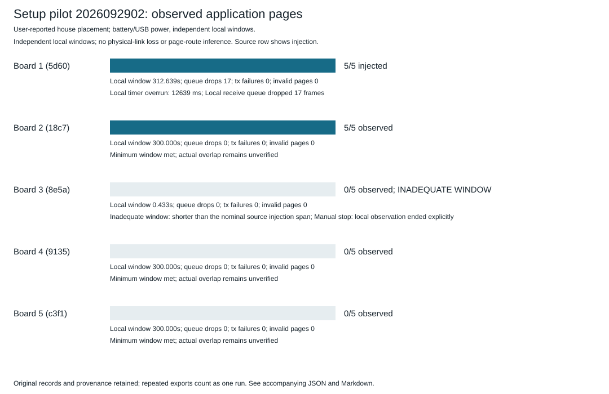
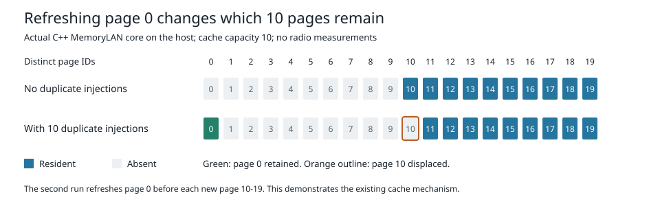

# Results

These are initial setup measurements and visualisation prototypes.

| Run | Setting | Report |
|---|---|---|
| 2026092801 | Two nearby boards | [Results](runs/2026092801.md) |
| 2026092901 | Five nearby boards | [Results](runs/2026092901.md) |
| 2026092902 | Five boards in the house | [Results](runs/2026092902.md) |

The raw inputs and their hashes are in [data/runs.json](../data/runs.json).
Repeated exports are not additional physical experiments. The house test did
not establish a working five-node path; node 3 stopped after 433 ms.



## Cache experiment

The actual C++ cache core was run with deterministic hardware substitutes.
This tests cache retention and refresh behaviour; it does not measure radio
delivery. Conditions, source hashes and results are in [cache.json](cach/cache.json).



Generate fresh outputs from a checkout:

```
python3 tool/report.py data/runs.json --out /path/to/new/reports
python3 tool/cache.py --out /path/to/new/cache-results
```

Each command requires a fresh output location. See [PLAN.md](../PLAN.md) for
the next experiments. LittleFS/uuencode retrieval is implemented and host-tested;
the new firmware has not yet been validated on boards.
