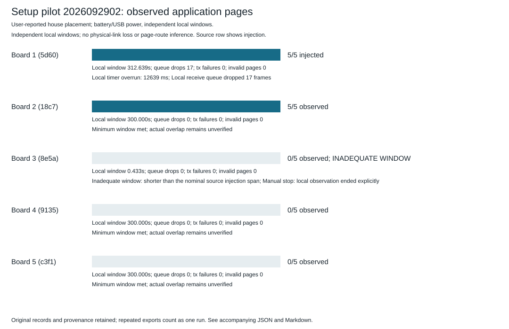
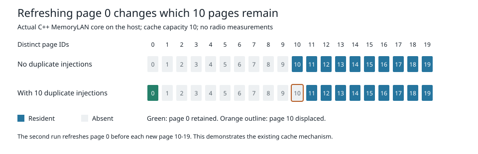

# Results

These are initial setup measurements and visualisation prototypes.

| Run | Setting | Report |
|---|---|---|
| 2026110201 | Controlled USB cache check; 5 received 4/5 after source removal | [Results](b1/README.md) |
| 2026110103 | Source off after one minute; delayed receiver 5 received 0/5 | [Results](h2/README.md) |
| 2026110101 | Five boards around the house; 11 directed links, two receivers at 4/5 | [Results](h1/README.md) |
| 2026103104-3109 | Five boards; two runs each at 32/64/120 bytes | [Results](size/README.md) |
| 2026103103 | Five-board repeat; 4/5 pages at each receiver | [Results](size/README.md) |
| 2026103102 | Five boards at the Mac; fixed identity colours | [Results](usb2/README.md) |
| 2026103101 | Five boards at the Mac; full MAC/topology logging | [Results](usb1/README.md) |
| 2026092801 | Two nearby boards | [Results](runs/2026092801.md) |
| 2026092901 | Five nearby boards | [Results](runs/2026092901.md) |
| 2026092902 | Five boards in the house | [Results](runs/2026092902.md) |

The controlled cache check is under [data/b1](../data/b1/). The source-off house
run is under [data/h2](../data/h2/); the first house run is under [data/h1](../data/h1/).
The size runs and the incomplete repeat are under [data/size](../data/size/).
The historical inputs and their hashes are in [data/runs.json](../data/runs.json).
Repeated exports are not additional physical experiments. The September house test did
not establish a working five-node path; node 3 stopped after 433 ms.



## Cache experiment

The actual C++ cache core was run with deterministic hardware substitutes.
This tests cache retention and refresh behaviour; it does not measure radio
delivery. Conditions, source hashes and results are in [cache.json](cach/cache.json).



Generate fresh outputs from a checkout:

```
python3 tool/report.py data/runs.json --out /path/to/new/reports
python3 tool/cache.py --out /path/to/new/cache-results
```

Each command requires a fresh output location. See [PLAN.md](../PLAN.md) for
the next experiments. The 31 October tests checked LittleFS/uuencode retrieval
and completed-file retention on all five boards. The 1 November house run
also retrieved both files from every board after the field test.
