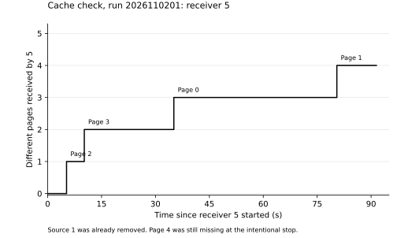
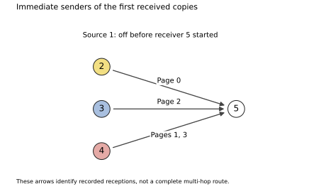

# Controlled cache check, 2 November 2026

Run `2026110201` used all five boards at the Mac, with no walk between them.
Pages travelled over BLE; USB was used for power, commands and retrieval.
All ran firmware `ca6fe90`. Node 1 injected five numbered 32-byte pages,
with at least 1,000 ms spacing.

Before removing the source, the live results of relays 2, 3 and 4 each showed
all five pages. Board 5 was still READY and empty. Source 1 was stopped at
4.358 seconds on its local clock and both files were retrieved. The user then
unplugged it. The controller required the source MAC to be absent from USB
and the relays to be RUNNING before starting 5 over USB.

**Board 5 received four of the five pages after source removal.** Its start
cleared the RAM cache and receive queue, and its trace contains no source-MAC
frames. The recorded immediate senders were the remaining relays:

| Page ID | First received by 5 (local s) | Sender |
|---|---|---|
| 0 | 35.116 | 2 |
| 1 | 80.475 | 4 |
| 2 | 5.260 | 3 |
| 3 | 10.198 | 4 |
| 4 | Not received | None |



This demonstrates **partial delivery from stored copies without the original
source**. It does not demonstrate full delivery: page 4 remained missing when
5 was intentionally stopped at 91.476 seconds. The clocks in this plot start
at receiver 5's activation; they are not one-way transmission delays.



These arrows identify the first recorded copies at 5, not a complete multi-hop
route. This nearby bench test does not establish house range or a forced
1--2--3--4--5 chain. The earlier [house source-off run](../h2/README.md) remains
separate: 5 received no pages there, and its limited radio contact and shared
active window do not identify one proven cause.

The configured local maximum was 300 seconds. All five records were stopped
intentionally: source 1 at 4.358 seconds, relays 2--4 at approximately 160--161
seconds, and receiver 5 after the roughly 90-second recovery window. No invalid
pages, queue drops, bad frames, send failures, ignored-run frames or topology
buffer overflows were reported. These counters do not establish zero radio loss.

All ten original files were retrieved with MAC, run, byte-count and CRC32 checks.
The [dataset](../../data/b1/) retains original file bytes, SHA-256/CRC32, the live
seeding witness, the pre-start READY/USB-absence check and host control times.
This run adds no new receiver power-cycle retention comparison.
[pages.csv](pages.csv) contains the reception table; [summary.json](summary.json)
also contains all observed directed links and result counters.

The next diagnostic is to record transmitted-page attempts, suppression choices
and current cache contents. That would help explain why a known stored page
remained missing even in this controlled window. Repeat the same setup before
comparing cache policies or claiming an optimal sending rate.

Recreate the verified summary and figures from the repository root:

```
python3 res/b1/plot.py
```

This requires Matplotlib. Input hashes, checksums, configuration, identities and
the control evidence are checked before plotting.
