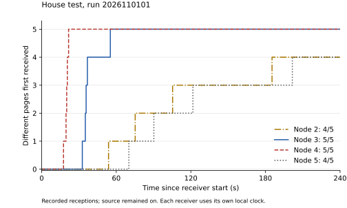
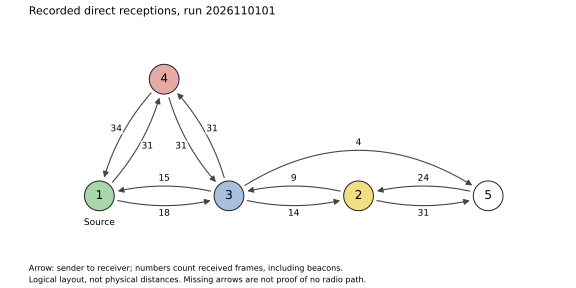
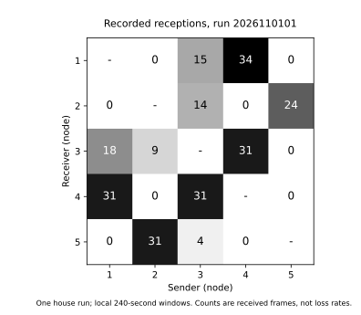

# House test, 1 November 2026

Run `2026110101` used five ESP32-S3-Zero boards around the house. Node 1
injected five numbered 32-byte pages with at least 1,000 ms spacing and stayed
on. Each board recorded its own 240-second window. All used firmware
`ca6fe90`.

| Receiver | Pages received | Missing page IDs | All five first received (local s) |
|---|---|---|---|
| 2 | 4/5 | 3 | Not complete |
| 3 | 5/5 | None | 55.251 |
| 4 | 5/5 | None | 21.674 |
| 5 | 4/5 | 3 | Not complete |

Page IDs start at 0. Page 3 was injected by the source and recorded at nodes
3 and 4, but not at 2 or 5 during their observation windows. The logs do not
establish why it remained missing. Zero diagnostic counters do not mean that
all radio transmissions arrived.



The curves use time since each receiver started. Exact receiver start times
were not recorded, and the clocks are not synchronised. These are not delays
measured from the source start. The intended start order was 5, 4, 3, 2, then
1; it is not an independently observed activation order. Source 1 was started
by USB at 22:38:59 Zurich time after the user reported the receivers blinking.

Eleven directed links were recorded. Both directions were heard for 1--3,
1--4, 3--4, 3--2 and 2--5. A further four frames were heard from 3 by 5;
none from 5 by 3. This describes the recorded windows, not permanent link
availability. The observed topology differs from the intended 1--2--3--4--5
chain.



The diagram is a logical layout. Numbers on arrows count received frames,
including beacons. They are not transmitted totals or loss rates. Node 2 first
received page 1 from node 5; node 5 first received that page from node 3.
These identify individual forwarding transmissions, not a reconstructed
complete path.



The plotted matrix reads sender column -> receiver row. The CSV uses sender
rows and receiver columns.

All five records finished automatically at 240,000 ms. No queue drops, bad
frames, invalid pages, send failures, ignored-run frames or topology-buffer
overflows were reported. All ten result/topology files were retrieved with
MAC, run, length and CRC32 checks. The user reported all LEDs steady before
collecting boards 2--5, disconnecting their power and reconnecting them at the
Mac. These receiver files were read after collection; there are no receiver
copies from before that disconnection for a byte-by-byte comparison. Source
1's repeated exports were identical.

The saved room names follow the placement plan: 1 laptop, 2 corridor, 3 living
room, 4 cellar and 5 hobby room. The user reported placing the boards, but
individual positions have not yet been confirmed. The MAC-to-number mapping
is verified; the room plan is not a measured floor plan.

The [raw exports and settings](../../data/h1/) retain the original bytes,
SHA-256/CRC32, full MACs and activation information. [summary.json](summary.json)
contains page reception times and immediate senders; [matrix.csv](matrix.csv)
contains the directed reception counts.

Next, test delivery after source 1 is switched off, with node 5 starting only
afterwards and relays 2--4 still running. This separates cached-copy delivery
from a receiver that already had the pages before the interruption. The
baseline shows that nodes 3 and 4 obtained all five pages; it does not promise
that the next test will deliver every page.

Recreate the report and figures from the repository root:

```
python3 res/h1/plot.py
```

This requires Matplotlib. The script checks file hashes, lengths, CRC32,
identities, run configuration and firmware before plotting.
