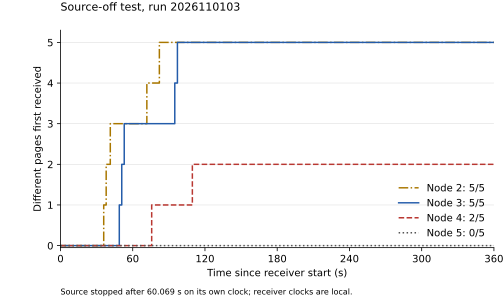
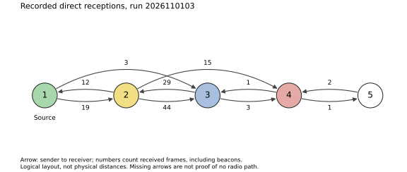
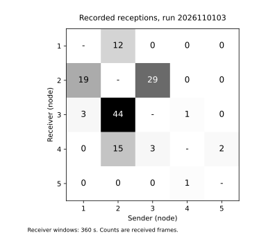

# Source-off test, 1 November 2026

Run `2026110103` was the second completed house experiment. The earlier
preparation attempt `2026110102` was abandoned after board 5 was accidentally
started and then interrupted; its record was preserved before using a fresh
shared run number.

Node 1 injected five numbered 32-byte pages, at least 1,000 ms apart. It was
stopped over USB after 60.069 seconds and its two files were retrieved before
the user unplugged it. Receivers 2--4 were intended to remain active. Board 5
was kept READY and the user reported starting it after source 1 was unplugged.
The configured local duration was 360 seconds on every board. All used
firmware `ca6fe90`.

| Receiver | Pages received | Received page IDs | All five first received (local s) |
|---|---|---|---|
| 2 | 5/5 | 0, 1, 2, 3, 4 | 82.130 |
| 3 | 5/5 | 0, 1, 2, 3, 4 | 97.126 |
| 4 | 2/5 | 3, 4 | Not complete |
| 5 | 0/5 | None | Not complete |

Nodes 2 and 3 had received all five pages before the source cutoff. The same
page-1 transmission from 2 (sequence 24) was recorded by source 1 at source-local
48.287 seconds and by 3 as its last missing page, before the 60.069-second cutoff.
This conclusion uses shared packet identities, not the unsynchronised plot axes.

**This run did not demonstrate page delivery to the delayed receiver 5.**
Its trace contains one beacon from board 4 at 61.111 seconds on 5's local
clock, but no page packets. Board 4 recorded two beacons from 5. Thus some
4--5 activity overlapped; the logs do not support saying that every relay
had already finished before 5 started.



The curves use each receiver's local start. Source 1's 60.069-second stop
cannot be drawn at 60.069 on those receiver axes. The exact physical unplug
and BOOT times were not recorded. The user reported source 1 off, then
clarified that 5 was fast white blinking; the correction supersedes an
intermediate answer that 5 was only powered. Report timestamps are not
button timestamps. The six-minute timers started separately, so the later start of 5 left a
shorter shared active window with the relays. No exact common-window duration
is assumed.

Board 5 clears its RAM cache, receive queue and topology trace when its trial
starts. This makes a delayed-start receiver suitable for checking cached-copy
delivery, but zero pages here is not positive evidence of that delivery.
It also does not establish that the cache mechanism is broken. Radio contact,
cache contents at the cutoff, forwarding choices and the shared active window
remain relevant. The final cache contents and transmitted-page attempts were
not recorded.

Ten directed links were observed. The pattern differs from the first house
run: source 1 heard only 2, and 5 heard only 4. The diagram counts all recorded
frames, including beacons, across different local windows; it is not a
simultaneous physical topology or a complete page route.





The plotted matrix reads sender column -> receiver row; the CSV uses sender
rows and receiver columns. This run had a longer receiver window and a delayed
receiver, so its counts are not a controlled loss-rate comparison with the
[first house run](../h1/README.md).

All five records are DONE. Source 1 has intentional stop reason 1 and elapsed
60,069 ms; receivers 2--5 have automatic stop reason 2 and elapsed 360,000 ms.
No invalid pages, queue drops, bad frames, send failures, ignored-run frames
or topology-buffer overflows were reported. These counters do not prove zero
radio loss.

All ten original files were retrieved with full MAC, run, byte-count and CRC32
checks. Source 1's repeated exports were byte-identical. The receiver exports
were collected after the user reconnected the boards; no receiver copies from
before that power transition are available for a byte comparison.

The room assignments are user-reported: 1 laptop, 2 corridor, 3 living room,
4 cellar and 5 hobby room, with the same places requested for this run. The
[raw files and settings](../../data/h2/) retain SHA-256/CRC32, identities and
activation reports. [summary.json](summary.json) contains page times, immediate
senders and directed reception counts. Page IDs start at zero.

The next small test should run at the USB hub, with no walk between boards.
Read the live relay results to confirm all five pages before stopping and
unplugging source 1. Then start 5 over USB while the relays are still RUNNING.
Record both control times. This checks the basic cache-delivery workflow before
another house repetition.

Recreate the report and figures from the repository root:

```
python3 res/h2/plot.py
```

This requires Matplotlib. The script checks original bytes, hashes, CRC32,
identity, firmware, run and page size before plotting.
