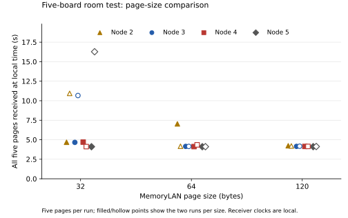

# Page-size check, 31 October 2026

A separate 32-byte repeat, run `2026103103`, stopped with **4/5 pages at every
receiver**; page 1 was missing. All five boards still heard each other, and all
ten files were retrieved. That result is preserved in
[data/size/base](../../data/size/base/). Its cause is still open.

We then tested 32, 64 and 120-byte pages twice each, in the order
32, 64, 120, 120, 64, 32. All five boards ran the same firmware, `ca6fe90`.
The new setting changes trial page length; the MemoryLAN forwarding protocol
was unchanged. Node 1 injected five pages with at least 1,000 ms spacing.
Each board recorded a 30-second local window. All boards stayed in the same
room, four on the hub and one directly on the Mac. The source remained on.

All four receivers received **5/5 pages in all six size runs**. The table gives
the local time when each receiver first had all five pages.

| Run | Page bytes | Node 2 (s) | Node 3 (s) | Node 4 (s) | Node 5 (s) | Directed links |
|---|---|---|---|---|---|---|
| 2026103104 | 32 | 4.676 | 4.662 | 4.695 | 4.107 | 20 |
| 2026103105 | 64 | 7.030 | 4.147 | 4.123 | 4.110 | 20 |
| 2026103106 | 120 | 4.224 | 4.150 | 4.144 | 4.113 | 20 |
| 2026103107 | 120 | 4.200 | 4.169 | 4.144 | 4.130 | 20 |
| 2026103108 | 64 | 4.160 | 4.146 | 4.347 | 4.111 | 20 |
| 2026103109 | 32 | 10.935 | 10.663 | 4.121 | 16.274 | 20 |



Filled and hollow points distinguish the two runs per size. Each point is one
receiver observation; four receivers in one run are not four independent
repetitions. The second 32-byte run had substantially later receptions than
the first. These six runs do not establish a preferred packet size or explain
the earlier incomplete run.

With five pages one second apart, the source itself needs at least four seconds
to introduce all pages. These times use independent receiver clocks and are
not one-way transmission delays. The page size includes the 14-byte trial
header. BLE adds a 19-byte envelope, before further controller/radio overhead.
The three sizes therefore send 160, 320 or 600 page bytes per run; this is not
an equal-byte-load throughput comparison. All five pages fit the ten-page
cache. Page length is separate from the size of the exported JSON log files.

Every size run recorded all 20 possible directed links. No queue drops, bad
frames, invalid pages, send failures, ignored-run frames or topology-buffer
overflows were reported. Reception counts and these counters do not establish
zero radio loss or a forced multi-hop route.

All 60 result/topology files were retrieved and checked using MAC, run number,
length and CRC32. They were byte-for-byte identical after hardware resets of
all five boards. The latest NVS results and all five stored labels also
survived. This series did not include another physical power-disconnection
test; that was checked in the [earlier run](../usb1/README.md).

The [raw data](../../data/size/) includes the original file bytes, SHA-256/CRC32,
full MAC identities, placement maps, settings and activation acknowledgements.
[summary.json](summary.json) contains per-page reception times, immediate
senders and each run's topology. [runs.csv](runs.csv) and
[receivers.csv](receivers.csv) give the compact tables.

Next, use the same labelled boards around the house and record the actual
links. Identity, topology and retrieval remain the priority. Sender-side page
attempts and final cache contents would help investigate delayed or missing
pages; those diagnostics are not implemented yet.

Recreate this report's data and figure from the repository root:

```
python3 res/size/plot.py
```

This requires Matplotlib. Input hashes, sizes, run IDs, firmware and identities
are checked before the report is regenerated.
