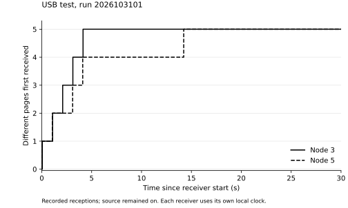
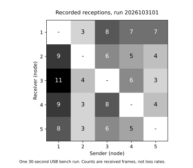

# USB bench, 31 October 2026

Run `2026103101` used five Waveshare ESP32-S3-Zero boards at the Mac: four on
the USB hub and one directly connected. All ran firmware `b25c2f8`. Node 1
injected five numbered 32-byte pages, spaced at least 1,000 ms apart. Each
board had a 30-second local observation window.

| Receiver | Pages received | Last missing page first received (local s) |
|---|---|---|
| 2 | 5/5 | 4.150 |
| 3 | 5/5 | 4.139 |
| 4 | 5/5 | 4.116 |
| 5 | 5/5 | 14.229 |

Node 5 received page 2 last, from node 1. Its earlier receptions of pages 1
and 3 were from node 3. The sender metadata identifies these individual
transmissions; it does not reconstruct an entire route.



All five boards heard all four other boards: 20 directed links. No queue
drops, bad frames, invalid pages, send failures or topology-buffer overflows
were reported. These counters do not establish a zero radio-loss rate.



The matrix reads sender column -> receiver row. The [directed graph](graph.svg)
shows the same observations.

Both the result and topology files were retrieved from every board and checked
using their MAC, run ID, length and CRC32. All ten files were byte-for-byte
identical after a restart and again after the user disconnected power from all
five boards and reconnected them. This confirms retention of completed log
files, not persistence of the RAM content cache.

The raw exports, placement map and run settings are in
[data/usb1](../../data/usb1/). [summary.json](summary.json) and
[matrix.csv](matrix.csv) describe the observed directed links.

These are nearby USB bench measurements. The clocks are local to each board;
the plotted times are not synchronised one-way latencies. This run does not
test house range or a forced 1-2-3-4-5 chain.

Recreate the topology report from the repository root:

```
python3 tool/topo.py data/usb1/*.top --labels data/usb1/labels.json --out out/top
```

`python3 res/usb1/plot.py` recreates the saved report and figures using Matplotlib.
