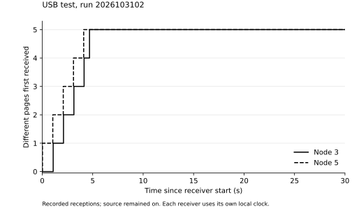
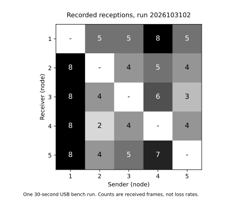

# USB bench, 31 October 2026

Run `2026103102` used five Waveshare ESP32-S3-Zero boards in the same room:
four on the USB hub and one directly connected to the Mac. All ran firmware
`2d9b46c`. Node 1 injected five numbered 32-byte pages, spaced at least
1,000 ms apart. Each board had a 30-second local observation window, and the
source remained on.

| Receiver | Pages received | All five first received (local s) |
|---|---|---|
| 2 | 5/5 | 4.160 |
| 3 | 5/5 | 4.685 |
| 4 | 5/5 | 4.119 |
| 5 | 5/5 | 4.108 |

Node 3 received page 0 last, from node 4. Node 5 first received page 2 from
node 3. This records the immediate transmitter of those receptions; it does
not establish a forced multi-hop route.



All five boards heard all four other boards: 20 directed links. No queue
drops, bad frames, invalid pages, send failures or topology-buffer overflows
were reported. These counters do not establish a zero radio-loss rate.



The matrix reads sender column -> receiver row and counts received frames,
including beacons. The [directed graph](graph.svg) shows the same observations.

Both files were retrieved from every board and checked using the full MAC,
run ID, length and CRC32. All ten files were byte-for-byte identical after a
hardware reset; the five current results and stored labels also remained
unchanged. Power was not disconnected again for this run. The separate
[earlier run](../usb1/README.md) checked completed-file retention after all
five boards were unplugged.

| Board | LED colour | Full hardware MAC |
|---|---|---|
| 1 | Green | `ac276eb0f9b4` |
| 2 | Yellow | `ac276eb0f9fc` |
| 3 | Blue | `ac276eb0059c` |
| 4 | Red | `ac276eafeb88` |
| 5 | White | `ac276eb00868` |

The stored number selects the colour. Slow blinking means prepared; fast
blinking means running; a steady identity colour means finished with both
archives saved. Magenta blinking means a storage or interruption problem.
Page delivery must be read from the saved results.

Raw exports, file hashes, settings, start acknowledgements and this run's
placement map are in [data/usb2](../../data/usb2/). The MAC identifies the
board; the run ID distinguishes this test from earlier ones.
[summary.json](summary.json) includes each page's first observed reception
and immediate sender. [matrix.csv](matrix.csv) stores sender rows and receiver
columns.

This nearby-room test checks communication and retrieval. It does not test
house range, a forced 1-2-3-4-5 chain or source-off cache recovery. The clocks
are local to each board; the times are not synchronised one-way latencies.
The next test is the same workflow with the five boards at their house
positions, recording extra or missing links.

Recreate the topology report from the repository root:

```
python3 tool/topo.py data/usb2/*.top --labels data/usb2/labels.json --out out/top
```

`python3 res/usb2/plot.py` recreates the report and figures using Matplotlib.
